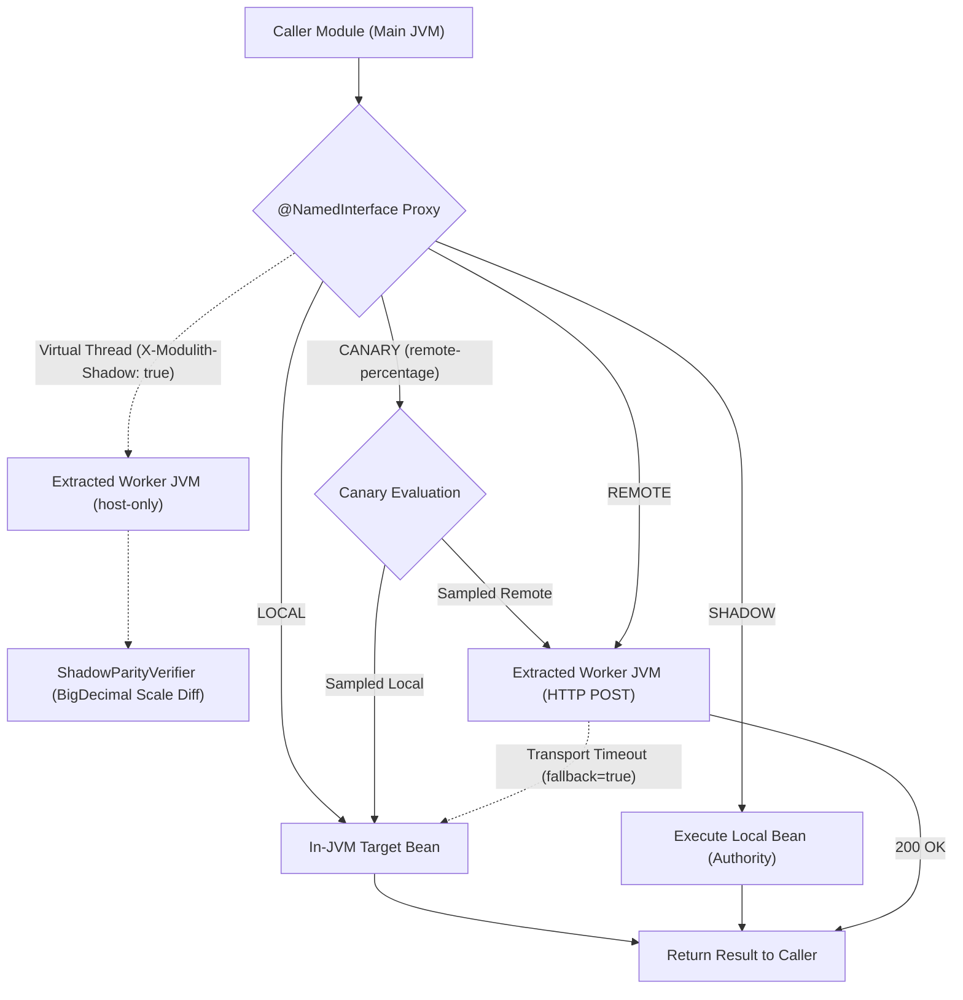

# Spring Modulith Strangler Bridge

[](https://central.sonatype.com/artifact/com.builtbyjuls/modulith-strangler-starter)
[](https://github.com/builtbyjuls/spring-modulith-strangler-bridge/actions/workflows/ci.yml)
[](https://opensource.org/licenses/MIT)

A reusable **Spring Boot 4.1 starter** (`modulith-strangler-starter`) that brings **zero-code microservice extraction**, **single-JAR runtime module slicing**, and **shadow parity verification** to **Spring Modulith** applications.

* **Tech Stack**: **Java 21** (Virtual Threads), **Spring Boot 4.1.x**, **Spring Modulith 2.1.1**, **PostgreSQL 16** (Testcontainers), **Hibernate ORM 7.x**.
* **Scope**: Enables modular monoliths to route `@NamedInterface` module calls across **`LOCAL`**, **`SHADOW`**, **`CANARY`**, and **`REMOTE`** modes via `application.yml` without changing domain code.

---

## Why This Project Exists

**Spring Modulith** enforces package boundaries inside a monolith (`@ApplicationModule`, `@NamedInterface`) and can externalize async events (`@Externalized`). However, when a hot module (like high-frequency telemetry aggregation) needs to scale on its own server, developers still face two major hurdles:

1. **Manual RPC Rewrites**: Turning synchronous `@NamedInterface` method calls into remote calls requires writing REST/gRPC controllers, HTTP clients, and serialization adapters by hand.
2. **No Runtime JAR Slicing**: Spring Modulith only slices modules in tests (`@ApplicationModuleTest`). Booting the production JAR as a separate worker node still loads every other module's beans and repositories into memory.

**`modulith-strangler-starter`** solves both problems with configuration:

1. **Single-JAR Runtime Slicing (`host-only`)**: Starts a worker JVM with `--modulith.bridge.host-only=metering` and strips all bean definitions from other modules (`settlement`, `contract`) before singleton creation.
2. **Hibernate Entity Slicing (`ModuleSliceEntityPostProcessor`)**: Prunes non-hosted JPA entities from the Hibernate metamodel, preventing tables and schemas of unused modules from loading into the worker persistence unit.
3. **Startup Contract Validation (`ModuleContractValidator`)**: Inspects `@NamedInterface` boundaries at startup and rejects leaked JPA entities or non-serializable streaming types.
4. **Zero-Code Proxy Routing (`LOCAL` / `SHADOW` / `CANARY` / `REMOTE`)**: Wraps `@NamedInterface` beans in a dynamic proxy that switches between in-JVM calls, shadow verification, canary traffic splitting, and remote HTTP calls via `application.yml`.
5. **Shadow Parity Verification & Traffic Sampling**: Runs `LOCAL` as authority while calling `REMOTE` in parallel on a **Java 21 Virtual Thread**, comparing results with scale-normalized `BigDecimal` precision with configurable sampling rates (`modulith.bridge.shadow-sample-rate`).
6. **Shadow Transaction Rollback (Dry-Run Writes)**: Enables safe shadow testing for write operations by sending `X-Modulith-Shadow: true`, executing the remote worker invocation in a rollback-only transaction after flushing constraints.
7. **Zero-Restart Live Mode Switching**: Dynamically updates routing topology and sampling rates at runtime without restarting JVMs via `GET / POST /internal/modulith-bridge/routes`.
8. **Resilient Fallback & Smart Error Classification**: Automatically falls back to the in-JVM implementation if the remote worker node times out during migration, while rethrowing legitimate domain exceptions directly to callers without fallback.
9. **Inbound Whitelisting & Secret Authentication**: Restricts worker RPC endpoints to `@NamedInterface` contracts and validates pre-shared `X-Modulith-Bridge-Secret` tokens (`modulith.bridge.secret-token`).
10. **Chatty RPC Loop Detection (`BridgeCallBudgetGuard`)**: Tracks per-thread sliding-window invocation frequency for `@NamedInterface` methods, warning or halting execution (`modulith.bridge.fail-on-chatty-boundary=true`) to detect N+1 loops before extracting to remote HTTP.
11. **Fast-Fail Circuit Breaker (`BridgeCircuitBreaker`)**: Trips `OPEN` after consecutive transport failures to fast-fail remote calls directly to `LOCAL` fallback in `0ms` without blocking on HTTP timeouts.
12. **Progressive Canary Traffic Splitting (`BridgeMode.CANARY`)**: Gradually shifts authoritative traffic (`0.0% -> 100.0%`) to the remote worker using configurable `remote-percentage`, avoiding all-or-nothing cutover cliffs while maintaining circuit breaker and local fallback safety.
13. **W3C Distributed Trace Context Propagation (`BridgeTraceContextHolder`)**: Propagates W3C trace headers (`traceparent`, `tracestate`, `baggage`, `X-Modulith-Correlation-Id`) across virtual threads and HTTP module hops, automatically binding context into SLF4J `MDC` on remote worker JVMs.

---

## Architecture Flow



---

## Sample Shadow Parity & Extraction Report

When running a module in **`SHADOW`** mode during strangler migration, the starter verifies calculation parity across `LOCAL` and `REMOTE` executions:

```text
[MODULITH STRANGLER BRIDGE] Module: metering | Mode: SHADOW
  Target Contract  : MeteringApi.aggregateDailyMeterVolumes(LocalDate)
  Worker Node      : http://localhost:54812 (Active Slice: [metering], Pruned: [contract, settlement])
  Local Latency    : 14.2 ms (20 contracts, 5,760 interval rows)
  Remote Latency   : 18.7 ms (HTTP POST /internal/modulith-bridge/invoke)
  Parity Status    : MATCH (20/20 records identical, BigDecimal scale normalized)
```

---

## Repository Structure

* **`modulith-strangler-starter/`**: Reusable **Spring Boot starter** containing `@EnableModulithBridge`, `ModuleSliceRegistryPostProcessor`, `ModuleSliceEntityPostProcessor`, `ModuleContractValidator`, `ModulithBridgeBeanPostProcessor`, `ModulithBridgeInboundController`, `BridgeBusinessException`, `ShadowParityVerifier`, `StranglerReportExporter`, and `DeploymentManifestGenerator`.
* **`grid-settlement-modulith-demo/`**: Wholesale **electricity market settlement modulith** modeling **288 daily 5-minute dispatch intervals** across `contract`, `metering`, and `settlement` modules.
* **`Dockerfile`**, **`docker-compose.yml`**, **`k8s/manifests.yaml`**: Reference containerization and Kubernetes orchestration manifests for single-image worker extraction.
* **`.github/workflows/ci.yml`**: GitHub Actions workflow running tests, uploading report artifacts, and publishing Markdown summaries to `$GITHUB_STEP_SUMMARY`.
* **[ARCHITECTURE.md](ARCHITECTURE.md)**: Full **architectural specification**, runtime slicing lifecycle, and trade-offs.

---

## Production Hardening Features

The starter includes ten production-grade reliability, security, and migration capabilities:

1. **Hibernate Entity Slicing (`ModuleSliceEntityPostProcessor`)**: In `host-only` mode, intercepts `LocalContainerEntityManagerFactoryBean` to prune non-hosted JPA `@Entity` classes from `PersistenceUnitInfo`, preventing foreign tables from polluting the worker metamodel or database schema validations.
2. **Startup Module Contract Validation (`ModuleContractValidator`)**: Inspects all `@NamedInterface` and `@ModulithBridgeTarget` contracts on startup (`modulith.bridge.validate-contracts=true`). Rejects method parameters or return types containing JPA `@Entity` types or non-serializable streams (`InputStream`, `OutputStream`, `Reader`, `Writer`).
3. **Inbound Interface Whitelisting & Secret Auth (`X-Modulith-Bridge-Secret`)**: Enforces that only whitelisted `@NamedInterface` or `@ModulithBridgeTarget` interfaces are exposed via `/internal/modulith-bridge/invoke` (`HTTP 403 Forbidden` otherwise). Validates pre-shared tokens using constant-time `MessageDigest.isEqual` (`HTTP 401 Unauthorized` on mismatch).
4. **Smart Error Classification (`BridgeBusinessException`)**: Differentiates between remote domain validation failures and transport failures. Domain errors are propagated directly to the caller, while transport and network errors trigger fallback to `LOCAL` when `fallbackToLocal=true`.
5. **Shadow Transaction Rollback & Traffic Sampling**: Enables safe shadow verification for mutating write methods. Attaches `X-Modulith-Shadow: true` on outbound shadow requests. The remote worker executes the target method inside a rollback-only transaction (`PROPAGATION_REQUIRES_NEW`), flushes `EntityManager` constraints, returns the computed DTO, and rolls back all database mutations. Configurable traffic sampling (`modulith.bridge.shadow-sample-rate`, `0.0` to `1.0`) controls shadow volume globally and per-module.
6. **Zero-Restart Live Mode Switching**: Exposes `GET` and `POST /internal/modulith-bridge/routes` (secured via `X-Modulith-Bridge-Secret`) to inspect and dynamically update routing modes (`LOCAL -> SHADOW -> CANARY -> REMOTE`), URLs, timeouts, fallback flags, sample rates, and canary percentages in-memory without JVM restarts.
7. **Chatty RPC Loop Detection (`BridgeCallBudgetGuard`)**: Identifies synchronous distributed monolith anti-patterns where callers invoke a `@NamedInterface` method inside a tight `for` loop. Monitors per-thread sliding-window call frequency (`modulith.bridge.max-calls-per-window`, `modulith.bridge.call-window-ms`). Warns or throws `ChattyModuleBoundaryException` (`modulith.bridge.fail-on-chatty-boundary=true`), advising callers to refactor to batch methods or Spring Modulith `@Externalized` async events.
8. **Fast-Fail Circuit Breaker (`BridgeCircuitBreaker`)**: Eliminates cascading timeout delays during worker outages. Tracks consecutive transport failures per module (`modulith.bridge.circuit-failure-threshold`). Trips to `OPEN` for `circuitResetTimeoutMs`, routing calls directly to `LOCAL` fallback in `0ms` without network overhead. Transitions to `HALF_OPEN` to permit a single probe request before recovering to `CLOSED`.
9. **Progressive Canary Traffic Splitting (`BridgeMode.CANARY`)**: Eliminates the high-risk cutover cliff between `SHADOW` and `REMOTE` by shifting authoritative production traffic incrementally (`modulith.bridge.remote-percentage` or per-module `remote-percentage`, `0.0` to `100.0`). Every canary call retains full `BridgeCircuitBreaker` fast-fail protection and local fallback.
10. **W3C Distributed Trace Context Propagation (`BridgeTraceContextHolder`)**: Preserves distributed observability across asynchronous virtual thread dispatch and HTTP transport. Binds W3C headers (`traceparent`, `tracestate`, `baggage`, `X-Modulith-Correlation-Id`) to and from SLF4J `MDC`, automatically generating a traceable correlation UUID when no upstream tracer is present.

---

## CI/CD Parity Reporting & Quality Gates

On application shutdown or explicit invocation, `StranglerReportExporter` writes audit artifacts to `target/strangler-reports/`. Reporting is **CI-platform agnostic**, allowing teams using GitLab CI, Jenkins, Azure DevOps, Bitbucket, CircleCI, or GitHub Actions to enforce parity gates without proprietary plugins:

* **`report.json`**: Machine-readable JSON report with timestamp, slice state, invocation totals, match/mismatch/fallback metrics, parity percentage, and full `ShadowParityResult` audit records (ideal for `jq` CLI gates and observability ingestion).
* **`junit-parity.xml`**: Standard JUnit XML test suite (`ModulithStranglerParity`) mapping each parity invocation to a `<testcase>` and mismatches to `<failure type="ShadowParityMismatch">`. Natively supported by GitLab CI, Jenkins, CircleCI, Bitbucket, and Azure DevOps test dashboards.
* **`summary.md`**: Clean Markdown tables formatted for GitHub Actions (`$GITHUB_STEP_SUMMARY`), GitLab merge request descriptions, or Azure DevOps build summaries.
* **Console ASCII Summary & Parity Gate**: Formatted ASCII summary banner logged directly to standard build logs (`modulith.bridge.log-console-summary=true`). Setting `modulith.bridge.fail-on-mismatch=true` automatically halts builds on any shadow mismatch via `ShadowParityMismatchException`.

### CI Integration Examples

#### GitLab CI (`.gitlab-ci.yml`)

```yaml
strangler-parity-test:
  stage: test
  script:
    - ./mvnw test -Dmodulith.bridge.fail-on-mismatch=true
  artifacts:
    when: always
    reports:
      junit: target/strangler-reports/junit-parity.xml
    paths:
      - target/strangler-reports/
```

#### Jenkins Pipeline (`Jenkinsfile`)

```groovy
stage('Shadow Parity') {
    steps {
        sh './mvnw test -Dmodulith.bridge.fail-on-mismatch=true'
    }
    post {
        always {
            junit 'target/strangler-reports/junit-parity.xml'
            archiveArtifacts artifacts: 'target/strangler-reports/**', allowEmptyArchive: true
        }
    }
}
```

#### GitHub Actions (`.github/workflows/ci.yml`)

```yaml
- name: Publish Step Summary
  if: always()
  run: |
    if [ -f target/strangler-reports/summary.md ]; then
      cat target/strangler-reports/summary.md >> $GITHUB_STEP_SUMMARY
    fi
```

#### Any CI Shell Gate (`jq`)

```bash
# Verify 100% parity rate using report.json
PARITY_RATE=$(jq -r '.parityRatePercent' target/strangler-reports/report.json)
if [ "$PARITY_RATE" != "100.0" ] && [ "$PARITY_RATE" != "100" ]; then
  echo "Strangler parity gate failed: $PARITY_RATE%"
  exit 1
fi
```

---

## Single-Image Container & Kubernetes Deployment

The project demonstrates single-JAR, single-image extraction where the identical application container image serves as both the central monolith and dedicated worker nodes:

* **`Dockerfile`**: Multi-stage Alpine container packaging the application with Java 21 JRE and direct CLI flag passthrough (`ENTRYPOINT ["java", "-jar", "/app/app.jar"]`).
* **`docker-compose.yml`**: Reference multi-container stack running PostgreSQL 16, an extracted `metering-worker` (`--modulith.bridge.host-only=metering`), and `modulith-main` wired over HTTP in `REMOTE` mode.
* **`k8s/manifests.yaml`**: Kubernetes `Deployment` and `Service` declarations for `modulith-main` and scaled `metering-worker` replicas (`replicas: 3`) with independent CPU and memory resource limits.
* **`DeploymentManifestGenerator`**: Programmatically generates customized `docker-compose.strangler.yml` and `k8s-strangler.yaml` manifests based on active `ModulithBridgeProperties`.

---

## Demo Scenarios (`grid-settlement-modulith-demo`)

The demo module tests **three strangler migration stages** across **288 five-minute energy intervals** (`5,760` telemetry rows per trading day):

* **Scenario A (`LOCAL` Monolith Baseline)**: `GridDailySettlementService` (`settlement` module) calls `ContractApi` (`contract` module) and `MeteringApi` (`metering` module) in-process with zero network hops.
* **Scenario B (`REMOTE` Extracted Worker + Runtime Slicing)**: Boots a separate `metering` worker node with `modulith.bridge.host-only=metering` (stripping `settlement` and `contract` beans) and routes `MeteringApi` calls over HTTP from the main node with `modulith.bridge.modules.metering.mode=REMOTE`.
* **Scenario C (`SHADOW` Parity & Safe Fallback)**: Executes `LOCAL` and `REMOTE` in parallel, verifies `BigDecimal` MWh parity across all 20 bilateral contracts, detects injected drift, and falls back to `LOCAL` when the remote worker is unavailable.

---

## Quick Start

### Prerequisites

* **Java 21+** and **Maven 3.9+**
* **Docker** (required for **Testcontainers PostgreSQL 16**)

### Run the Tests

```bash
# 1. Clone the repository
git clone https://github.com/builtbyjuls/spring-modulith-strangler-bridge.git
cd spring-modulith-strangler-bridge

# 2. Run the Testcontainers suite
./mvnw test
```

### Maven / Gradle Dependency

Add `modulith-strangler-starter` to your application:

#### Maven (`pom.xml`)

```xml
<dependency>
    <groupId>com.builtbyjuls</groupId>
    <artifactId>modulith-strangler-starter</artifactId>
    <version>0.1.0</version>
</dependency>
```

#### Gradle (`build.gradle`)

```groovy
implementation 'com.builtbyjuls:modulith-strangler-starter:0.1.0'
```

---

## License

This project is licensed under the MIT License - see the [MIT](LICENSE) license for details.
