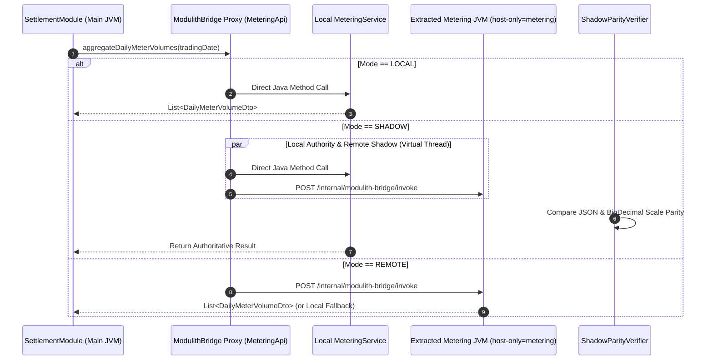

# Spring Modulith Strangler Bridge

A reusable **Spring Boot 4.1 starter** (`modulith-strangler-starter`) that brings **zero-code microservice extraction**, **single-JAR runtime module slicing**, and **shadow parity verification** to **Spring Modulith** applications.

* **Tech Stack**: **Java 21** (Virtual Threads), **Spring Boot 4.1.x**, **Spring Modulith 2.1.1**, **PostgreSQL 16** (Testcontainers), **Hibernate ORM 7.x**.
* **Scope**: Enables modular monoliths to route `@NamedInterface` module calls across **`LOCAL`**, **`SHADOW`**, and **`REMOTE`** modes via `application.yml` without changing domain code.

---

## Why This Project Exists

**Spring Modulith** enforces package boundaries inside a monolith (`@ApplicationModule`, `@NamedInterface`) and can externalize async events (`@Externalized`). However, when a hot module (like high-frequency telemetry aggregation) needs to scale on its own server, developers still face two major hurdles:

1. **Manual RPC Rewrites**: Turning synchronous `@NamedInterface` method calls into remote calls requires writing REST/gRPC controllers, HTTP clients, and serialization adapters by hand.
2. **No Runtime JAR Slicing**: Spring Modulith only slices modules in tests (`@ApplicationModuleTest`). Booting the production JAR as a separate worker node still loads every other module's beans and repositories into memory.

**`modulith-strangler-starter`** solves both problems with configuration:

1. **Single-JAR Runtime Slicing (`host-only`)**: Starts a worker JVM with `--modulith.bridge.host-only=metering` and strips all bean definitions from other modules (`settlement`, `contract`) before singleton creation.
2. **Zero-Code Proxy Routing (`LOCAL` / `SHADOW` / `REMOTE`)**: Wraps `@NamedInterface` beans in a dynamic proxy that switches between in-JVM calls and remote HTTP calls via `application.yml`.
3. **Shadow Parity Verification**: Runs `LOCAL` as authority while calling `REMOTE` in parallel on a **Java 21 Virtual Thread**, comparing results with scale-normalized `BigDecimal` precision before full cutover.
4. **Resilient Local Fallback**: Automatically falls back to the in-JVM implementation if the remote worker node times out during migration.

---

## Sequence Flow



---

## Sample Shadow Parity & Extraction Report

When running a module in **`SHADOW`** mode during strangler migration, the starter verifies calculation parity across `LOCAL` and `REMOTE` executions:

```text
[MODULITH STRANGLER BRIDGE] Module: metering | Mode: SHADOW
  Target Contract  : MeteringApi.aggregateDailyMeterVolumes(LocalDate)
  Worker Node      : http://localhost:54812 (Active Slice: [metering], Pruned: [contract, settlement])
  Local Latency    : 14.2 ms (20 contracts, 5,760 interval rows)
  Remote Latency   : 18.7 ms (HTTP POST /internal/modulith-bridge/invoke)
  Parity Status    : MATCH (20/20 records identical, BigDecimal scale normalized)
```

---

## Repository Structure

* **`modulith-strangler-starter/`**: Reusable **Spring Boot starter** containing `@EnableModulithBridge`, `ModuleSliceRegistryPostProcessor`, `ModulithBridgeBeanPostProcessor`, `ModulithBridgeInboundController`, `ShadowParityVerifier`, `StranglerReportExporter`, and `DeploymentManifestGenerator`.
* **`grid-settlement-modulith-demo/`**: Wholesale **electricity market settlement modulith** modeling **288 daily 5-minute dispatch intervals** across `contract`, `metering`, and `settlement` modules.
* **`Dockerfile`**, **`docker-compose.yml`**, **`k8s/manifests.yaml`**: Reference containerization and Kubernetes orchestration manifests for single-image worker extraction.
* **`.github/workflows/ci.yml`**: GitHub Actions workflow running tests, uploading report artifacts, and publishing Markdown summaries to `$GITHUB_STEP_SUMMARY`.
* **[ARCHITECTURE.md](ARCHITECTURE.md)**: Full **architectural specification**, runtime slicing lifecycle, and trade-offs.

---

## CI/CD Parity Reporting

On application shutdown or explicit invocation, `StranglerReportExporter` writes audit artifacts to `target/strangler-reports/`:

* **`report.json`**: Machine-readable JSON report with timestamp, slice state, invocation totals, match/mismatch/fallback metrics, parity percentage, and full `ShadowParityResult` audit records.
* **`summary.md`**: GitHub-flavored Markdown report rendered to `$GITHUB_STEP_SUMMARY` in CI pipelines, documenting metrics, module routing topology, and invocation outcomes.

---

## Single-Image Container & Kubernetes Deployment

The project demonstrates single-JAR, single-image extraction where the identical application container image serves as both the central monolith and dedicated worker nodes:

* **`Dockerfile`**: Multi-stage Alpine container packaging the application with Java 21 JRE and direct CLI flag passthrough (`ENTRYPOINT ["java", "-jar", "/app/app.jar"]`).
* **`docker-compose.yml`**: Reference multi-container stack running PostgreSQL 16, an extracted `metering-worker` (`--modulith.bridge.host-only=metering`), and `modulith-main` wired over HTTP in `REMOTE` mode.
* **`k8s/manifests.yaml`**: Kubernetes `Deployment` and `Service` declarations for `modulith-main` and scaled `metering-worker` replicas (`replicas: 3`) with independent CPU and memory resource limits.
* **`DeploymentManifestGenerator`**: Programmatically generates customized `docker-compose.strangler.yml` and `k8s-strangler.yaml` manifests based on active `ModulithBridgeProperties`.

---

## Demo Scenarios (`grid-settlement-modulith-demo`)

The demo module tests **three strangler migration stages** across **288 five-minute energy intervals** (`5,760` telemetry rows per trading day):

* **Scenario A (`LOCAL` Monolith Baseline)**: `GridDailySettlementService` (`settlement` module) calls `ContractApi` (`contract` module) and `MeteringApi` (`metering` module) in-process with zero network hops.
* **Scenario B (`REMOTE` Extracted Worker + Runtime Slicing)**: Boots a separate `metering` worker node with `modulith.bridge.host-only=metering` (stripping `settlement` and `contract` beans) and routes `MeteringApi` calls over HTTP from the main node with `modulith.bridge.modules.metering.mode=REMOTE`.
* **Scenario C (`SHADOW` Parity & Safe Fallback)**: Executes `LOCAL` and `REMOTE` in parallel, verifies `BigDecimal` MWh parity across all 20 bilateral contracts, detects injected drift, and falls back to `LOCAL` when the remote worker is unavailable.

---

## Quick Start

### Prerequisites

* **Java 21+** and **Maven 3.9+**
* **Docker** (required for **Testcontainers PostgreSQL 16**)

### Run the Tests

```bash
# 1. Clone the repository
git clone https://github.com/builtbyjuls/spring-modulith-strangler-bridge.git
cd spring-modulith-strangler-bridge

# 2. Run the Testcontainers suite
./mvnw test
```
